# DEPOLEDGER

## Enterprise Tokenised Deposits & Bank Funding Infrastructure

**Daml · Canton · Domain-Driven Design · Hexagonal Architecture · Event-Driven Integration**

DEPOLEDGER is a proposed enterprise banking platform for issuing, administering, transferring where permitted, redeeming, and reconciling tokenised representations of bank deposit liabilities.

The platform combines Daml-based financial agreements with controlled banking workflows, Canton privacy and participant coordination, core banking integrations, treasury operations, compliance controls, payment settlement coordination, and general-ledger reconciliation.

Its primary design objective is to ensure that every financial operation has an authorized actor, valid contractual preconditions, appropriate approval, controlled execution, recoverable operational state, and auditable financial evidence.

> **Implementation status:** This README defines the target architecture and planned workflows. A documented component or diagram does not imply that the corresponding implementation is already complete.

---

# Table of Contents

1. [Product Overview](#1-product-overview)
2. [Architecture Principles](#2-architecture-principles)
3. [Business Scope](#3-business-scope)
4. [Actors and Responsibilities](#4-actors-and-responsibilities)
5. [Technology Stack](#5-technology-stack)
6. [Repository Structure](#6-repository-structure)
7. [System Context](#7-system-context)
8. [Enterprise Architecture](#8-enterprise-architecture)
9. [Domain-Driven Design](#9-domain-driven-design)
10. [Hexagonal Architecture](#10-hexagonal-architecture)
11. [Daml Contract Architecture](#11-daml-contract-architecture)
12. [Deposit Product and Data Model](#12-deposit-product-and-data-model)
13. [Authorization and Approval Framework](#13-authorization-and-approval-framework)
14. [Deposit Issuance Workflow](#14-deposit-issuance-workflow)
15. [Token Transfer Workflow](#15-token-transfer-workflow)
16. [Redemption and Withdrawal Workflow](#16-redemption-and-withdrawal-workflow)
17. [Time Deposits, Interest, and Maturity](#17-time-deposits-interest-and-maturity)
18. [Treasury and Interbank Funding](#18-treasury-and-interbank-funding)
19. [Brokered, Structured, and Islamic Deposits](#19-brokered-structured-and-islamic-deposits)
20. [Workflow Orchestration and State Machines](#20-workflow-orchestration-and-state-machines)
21. [Core Banking and Settlement Integration](#21-core-banking-and-settlement-integration)
22. [Accounting and Reconciliation](#22-accounting-and-reconciliation)
23. [Security Architecture](#23-security-architecture)
24. [Privacy and Data Governance](#24-privacy-and-data-governance)
25. [Deployment Architecture](#25-deployment-architecture)
26. [Observability and Operational Resilience](#26-observability-and-operational-resilience)
27. [Testing Strategy](#27-testing-strategy)
28. [Development Environment](#28-development-environment)
29. [Regulatory and Legal Considerations](#29-regulatory-and-legal-considerations)
30. [Implementation Roadmap](#30-implementation-roadmap)
31. [Production Readiness](#31-production-readiness)
32. [Glossary](#32-glossary)

---

# 1. Product Overview

DEPOLEDGER provides a controlled digital representation of eligible bank deposit entitlements.

It is not simply a token contract or a blockchain application. It is a financial workflow platform that coordinates contractual obligations, authorized ledger operations, external banking systems, settlement evidence, and accounting controls.

## 1.1 Business objectives

- Preserve the issuing bank's contractual deposit obligations.
- Prevent unauthorized or unsupported token issuance.
- Implement configurable deposit products using reusable Daml modules.
- Support controlled transfers between eligible participants.
- Automate notice periods, interest, maturity, rollover, and redemption workflows.
- Coordinate ledger operations with core banking and payment systems.
- Enforce maker-checker approval and delegated authority.
- Detect and resolve discrepancies between deposit records, token positions, and accounting records.
- Maintain attributable, reviewable audit evidence.
- Enable future institutional funding and interbank settlement workflows.

## 1.2 Core financial principle

A tokenised representation must correspond to an authorized deposit entitlement under the bank's approved legal and operational model.

For a fully tokenised deposit product, the target relationship is:

\[
\text{Tokenised entitlement}
=
\text{Corresponding deposit entitlement}
\]

This relationship must account for partial tokenisation, accrued interest, fees, holds, and any non-tokenised balance.

Nominal equality alone does not prove legal enforceability, sufficient liquidity, or external payment finality.

## 1.3 System context

The following diagram shows DEPOLEDGER's primary actors and external systems.

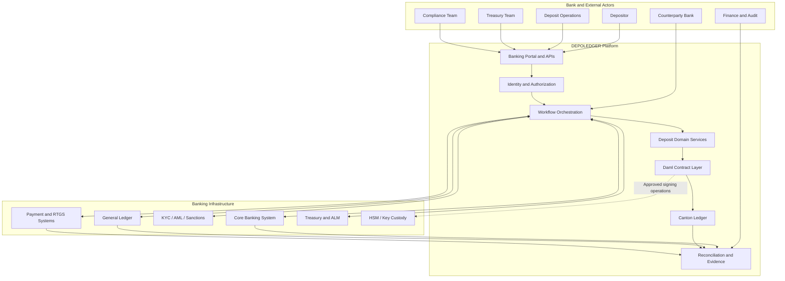

The system boundaries are deliberate:

- Daml and Canton enforce ledger-side contractual rules and authorized state transitions.
- Application services implement API access, orchestration, and integration logic.
- Core banking remains authoritative for the deposit records assigned to it.
- Payment infrastructure provides evidence of external payment outcomes.
- Finance and reconciliation establish whether financial records agree.

---

# 2. Architecture Principles

DEPOLEDGER follows these principles throughout the implementation.

| Principle | Engineering requirement |
|---|---|
| Contractual integrity | Digital representations must preserve the agreed deposit obligations. |
| Domain-driven design | Each bounded context owns a clearly defined business capability. |
| Hexagonal architecture | Domain logic remains independent of technology-specific adapters. |
| Least privilege | Every party and service receives only the authority required for its responsibilities. |
| Separation of duties | Initiation, approval, execution, and independent review are separated where required. |
| Explicit state | Deposit lifecycle, transaction execution, settlement, and reconciliation remain distinct. |
| Durable workflows | Restarts, timeouts, duplicate messages, and partial failures are expected conditions. |
| Idempotency | Repeated instructions must not create duplicate financial effects. |
| Privacy by design | Sensitive data is disclosed only to authorized participants. |
| Reconciliation by default | Financial differences generate explicit, traceable exceptions. |
| Governed extensibility | New products cannot bypass common authorization and integrity controls. |

## 2.1 Architecture decision boundaries

Daml contracts should enforce rules that must hold when a ledger transaction executes.

External services should perform operations that depend on external systems, including:

- Customer onboarding and authoritative identity verification.
- KYC, AML, sanctions, and fraud screening integrations.
- Core banking posting and reservation.
- Payment initiation and settlement confirmation.
- Interest calculation services where product complexity requires them.
- Durable long-running workflow orchestration.
- Operational monitoring, reporting, and exception management.

These responsibilities may interact, but they should not be implemented as if they share a single atomic transaction.

---

# 3. Business Scope

## 3.1 Initial release

The recommended first release supports a restricted single-bank corporate deposit use case.

| Capability | Initial scope |
|---|---|
| Customer eligibility | Eligible corporate customers and authorized signatories |
| Deposit products | One approved demand-deposit product |
| Issuance | Authorized issuance with duplicate prevention |
| Transfers | Transfers between eligible participants where contractually permitted |
| Redemption | Controlled redemption and withdrawal coordination |
| Approvals | Maker-checker and delegated authority |
| Compliance | Integration with approved screening services |
| Accounting | Core banking and general-ledger reconciliation |
| Operations | Durable workflows, audit evidence, and exception queues |

## 3.2 Future product families

| Product family | Additional requirements |
|---|---|
| Demand deposits | Available balances, holds, withdrawal permissions |
| Time deposits | Interest, maturity, early redemption, rollover |
| Notice deposits | Notice submission, effective dates, revocation policy |
| Call deposits | Call instructions and repayment deadlines |
| Wholesale deposits | Negotiated terms, funding limits, concentration monitoring |
| Interbank deposits | Counterparty eligibility and settlement coordination |
| Brokered deposits | Broker authorization and ownership provenance |
| Structured deposits | Approved payoff formula and observation schedule |
| Islamic deposit arrangements | Contract-specific ownership, profit allocation, and loss treatment |

Each product family must have its own approved contractual model, lifecycle rules, and acceptance tests.

---

# 4. Actors and Responsibilities

| Actor | Responsibilities |
|---|---|
| Depositor | Accepts terms and submits authorized instructions |
| Authorized Signatory | Acts within the customer's account mandate |
| Relationship Manager | Initiates eligible customer deposit requests |
| Deposit Operations Maker | Initiates controlled deposit operations |
| Deposit Operations Checker | Independently verifies designated operations |
| Branch / Operations Manager | Approves authorized exceptions |
| Treasury Dealer | Proposes funding and interbank transactions |
| Treasury Manager | Approves transactions within delegated authority |
| ALM / Liquidity Risk Officer | Monitors maturity gaps and funding concentrations |
| Compliance Officer | Reviews screening decisions and restrictions |
| Fraud Analyst | Investigates suspicious transaction patterns |
| Finance Officer | Reconciles accounting records and exceptions |
| Product Manager | Proposes product configurations and versions |
| Legal / Sharia Reviewer | Reviews applicable contractual structures |
| Information Security Officer | Governs access, key security, and incidents |
| Internal Auditor | Independently reviews evidence and control effectiveness |
| System Administrator | Operates infrastructure without automatic financial authority |
| Core Banking System | Maintains authoritative deposit records where designated |
| General Ledger | Maintains accounting entries |
| Payment Infrastructure | Executes payments and supplies settlement evidence |
| Canton Participants | Operate the ledger infrastructure under network governance |

A user identity, an application role, a Canton party, and a Daml contract stakeholder are not interchangeable concepts. Their relationships must be explicitly established and validated.

---

# 5. Technology Stack

| Layer | Technology or approach |
|---|---|
| Contract modeling | Daml |
| Distributed ledger | Canton |
| Development toolchain | Daml SDK or supported DPM workflow |
| Contract testing | Daml Script and supported testing tools |
| Backend | Strongly typed service architecture |
| API | REST for external interfaces; gRPC where appropriate |
| Workflow orchestration | Durable orchestration engine or equivalent |
| Operational database | Relational database with transactional integrity |
| Event distribution | Durable message broker and schema governance |
| Identity | Enterprise identity provider, OIDC, MFA, service authentication |
| Key custody | Institution-approved HSM or equivalent |
| Observability | Centralized logs, metrics, traces, and alerting |
| Deployment | Hardened containers or bank-approved infrastructure |
| Reporting | Governed data platform and reconciled reporting datasets |

Technology versions and commands must follow the repository's actual configuration. Avoid mixing incompatible Daml SDK, DPM, and Canton versions.

---

# 6. Repository Structure

DEPOLEDGER should begin as a manageable Daml project and evolve as its domain boundaries become clear.

```mermaid
flowchart TD
    Root["depoledger/"]
    Root --> Config["daml.yaml"]
    Root --> README["README.md"]
    Root --> Daml["daml/"]
    Root --> Integration["integration/"]
    Root --> Scripts["scripts/"]
    Root --> Docs["docs/"]

    Daml --> Common["Common/"]
    Daml --> Governance["Governance/"]
    Daml --> Products["Products/"]
    Daml --> Deposits["Deposits/"]
    Daml --> Issuance["Issuance/"]
    Daml --> Transfers["Transfers/"]
    Daml --> Redemption["Redemption/"]
    Daml --> Maturity["Maturity/"]
    Daml --> Treasury["Treasury/"]
    Daml --> Settlement["Settlement/"]
    Daml --> Reconciliation["Reconciliation/"]
    Daml --> Audit["Audit/"]
    Daml --> Tests["Tests/"]

    Integration --> Adapters["Core Banking / GL / Payments"]
    Integration --> Orchestrator["Workflow Orchestrator"]
    Integration --> Events["Event Consumers and Publishers"]

    Docs --> ADR["Architecture Decision Records"]
    Docs --> Runbooks["Operational Runbooks"]
    Docs --> Workflows["Workflow Specifications"]
```

## 6.1 Suggested file layout

```text
depoledger/
├── README.md
├── daml.yaml
├── daml/
│   ├── Main.daml
│   ├── Common/
│   │   ├── Types.daml
│   │   ├── Identifiers.daml
│   │   └── Errors.daml
│   ├── Governance/
│   │   ├── Roles.daml
│   │   ├── Policies.daml
│   │   └── Approvals.daml
│   ├── Products/
│   │   ├── DepositProduct.daml
│   │   └── ProductVersion.daml
│   ├── Deposits/
│   │   ├── DepositAgreement.daml
│   │   ├── DepositLifecycle.daml
│   │   └── DepositPosition.daml
│   ├── Issuance/
│   │   ├── IssuanceRequest.daml
│   │   └── IssuanceApproval.daml
│   ├── Transfers/
│   │   ├── TransferRequest.daml
│   │   └── TransferAcceptance.daml
│   ├── Redemption/
│   │   ├── RedemptionRequest.daml
│   │   └── RedemptionApproval.daml
│   ├── Maturity/
│   │   ├── InterestTerms.daml
│   │   └── MaturityInstruction.daml
│   ├── Treasury/
│   │   ├── FundingProposal.daml
│   │   └── CounterpartyAgreement.daml
│   ├── Settlement/
│   │   ├── SettlementInstruction.daml
│   │   └── SettlementConfirmation.daml
│   ├── Reconciliation/
│   │   ├── ReconciliationCase.daml
│   │   └── ReconciliationEvidence.daml
│   ├── Audit/
│   │   └── AuditEvidence.daml
│   └── Tests/
│       ├── DepositTests.daml
│       ├── IssuanceTests.daml
│       ├── TransferTests.daml
│       └── RedemptionTests.daml
├── integration/
│   ├── core-banking/
│   ├── general-ledger/
│   ├── payments/
│   ├── compliance/
│   └── settlement/
├── scripts/
└── docs/
    ├── architecture/
    ├── workflows/
    ├── security/
    └── operations/
```

This is a target layout. Create files incrementally rather than generating empty modules for every planned capability.

### Package strategy

Use one Daml package initially when the modules share a release lifecycle and dependency boundary.

Introduce separate packages when independent versioning, deployment, dependency management, or a real access boundary justifies the additional complexity. Separate packages alone do not establish security isolation.

---

# 7. System Context

The following diagram distinguishes the contractual ledger from external financial systems.

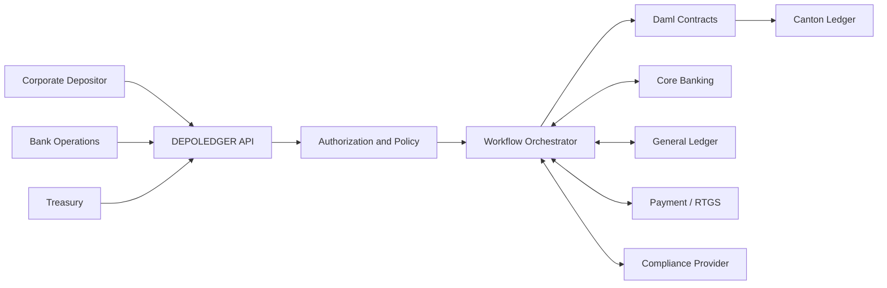

The architecture must explicitly define which system is authoritative for every important financial field and event.

---

# 8. Enterprise Architecture

DEPOLEDGER uses layered architecture with clear responsibilities.

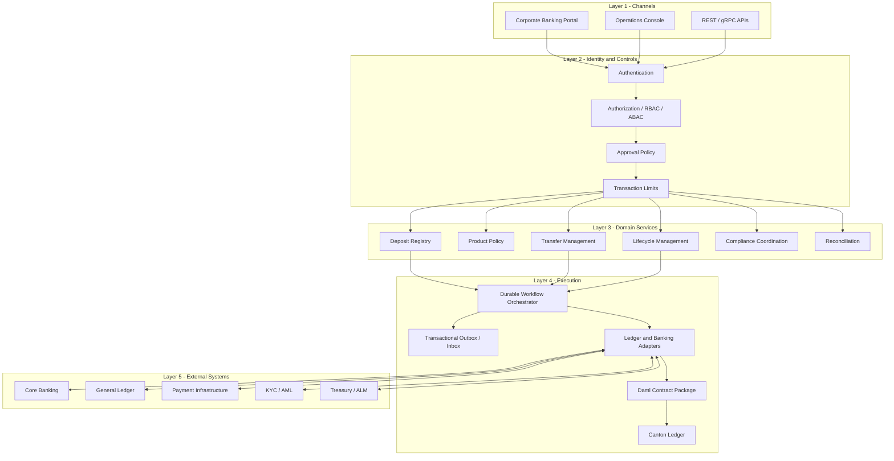

### Architectural boundaries

- **Channels:** collect and display instructions.
- **Identity and controls:** authenticate actors and evaluate authority.
- **Domain services:** implement business use cases and policies.
- **Workflow execution:** coordinate long-running operations and external systems.
- **Daml/Canton:** enforce ledger-side agreement rules and contract transitions.
- **External systems:** maintain their designated authoritative financial records.

---

# 9. Domain-Driven Design

DEPOLEDGER separates banking capabilities into bounded contexts.

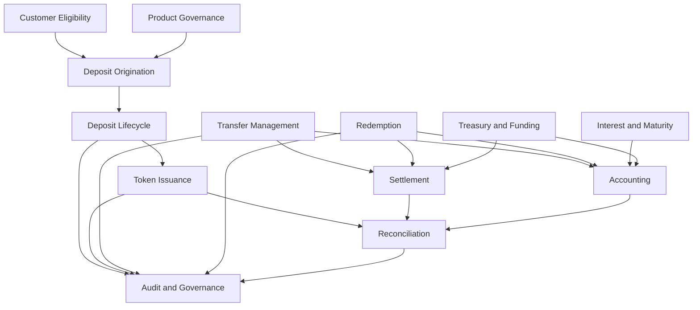

## 9.1 Bounded-context ownership

| Context | Owns | Does not own |
|---|---|---|
| Customer Eligibility | Eligibility decisions and evidence references | Authoritative customer identity records |
| Product Governance | Approved product versions and policies | Unilateral changes to existing contractual terms |
| Deposit Origination | Application and agreed deposit terms | External core banking balances |
| Deposit Lifecycle | Deposit state and permitted transitions | External payment finality |
| Token Issuance | Issuance workflow and authorized ledger instructions | Unrestricted creation of deposit liabilities |
| Transfer Management | Transfer instructions and policy outcomes | All external payment and accounting state |
| Redemption | Redemption requests and lifecycle coordination | Guaranteed completion of external payout |
| Interest and Maturity | Calculation rules and maturity instructions | Unapproved pricing decisions |
| Treasury and Funding | Funding proposals, limits, and placements | Customer identity master data |
| Settlement | Payment instructions and settlement evidence | Unilateral alteration of deposit obligations |
| Accounting | Posting requests and journal references | Ledger consensus |
| Reconciliation | Cross-system comparisons and exception cases | Silent rewriting of authoritative records |
| Audit and Governance | Evidence, policy versions, and review records | Transaction initiation authority |

Each context must expose explicit interfaces and events. Cross-context changes should be coordinated through defined application workflows.

---

# 10. Hexagonal Architecture

Each domain service should follow hexagonal architecture.

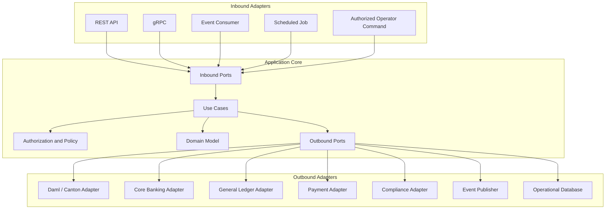

### Rules

1. Domain logic must not depend on HTTP frameworks, database vendors, or blockchain SDKs.
2. Use cases coordinate business operations.
3. Outbound ports define required external capabilities.
4. Adapters implement technology-specific communication.
5. Integration failures must be translated into explicit domain or workflow outcomes.
6. Authorization decisions must be checked at the correct execution boundary, not inferred from a user-interface role.

---

# 11. Daml Contract Architecture

Daml models agreements through contracts, parties, signatories, observers, and authorized choices.

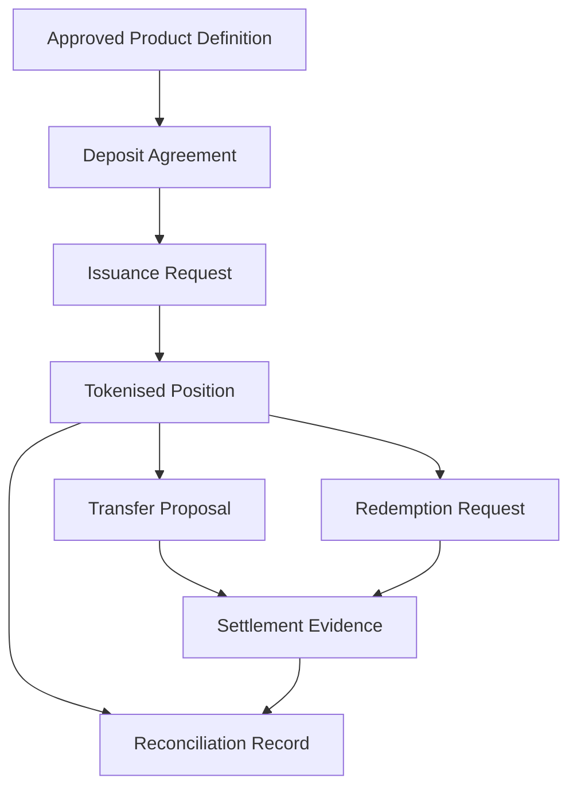

## 11.1 Conceptual contract responsibilities

| Contract or type | Responsibility |
|---|---|
| DepositProduct | Approved product parameters |
| ProductVersion | Immutable reference to applicable terms |
| DepositAgreement | Contractual deposit relationship |
| DepositPosition | Eligible digital representation |
| IssuanceRequest | Request and approval workflow for issuance |
| TransferRequest | Proposed transfer and required acceptance |
| RedemptionRequest | Controlled redemption workflow |
| ApprovalRecord | Evidence of a required approval |
| SettlementReference | Reference to external settlement evidence |
| ReconciliationCase | Controlled discrepancy investigation |

The final implementation may use a combination of Daml templates and data types. Not every conceptual entity needs to be a separate on-ledger contract.

## 11.2 Contract design checklist

Every contract should define:

- Its purpose and lifecycle.
- Required signatories.
- Observers, if any, and their justified visibility.
- Authorized choice controllers.
- Preconditions and validation rules.
- Resulting contracts and consumed contracts.
- Privacy and information disclosure.
- Termination or archival behavior.
- External references needed for reconciliation.

### Important Daml constraints

- Contract creation requires the declared signatories.
- A choice is authorized according to its controller expression.
- A controller must not be assumed to have authority merely because it appears in a data field.
- Contract visibility is governed by Daml and Canton semantics, not simply by application RBAC.
- A contract archive does not erase the historical ledger transaction.
- A Daml transaction cannot atomically commit an unrelated core banking database transaction or an external payment.

---

# 12. Deposit Product and Data Model

## 12.1 Logical data model

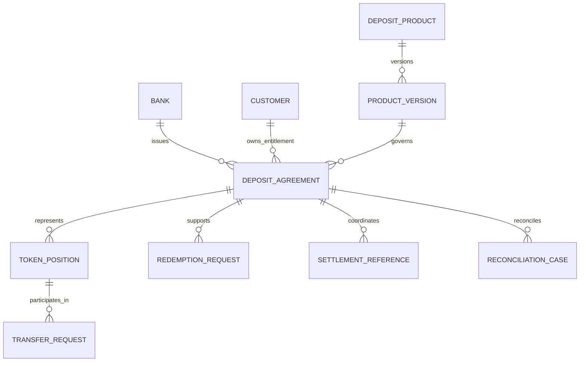

This ER diagram is a logical business model, not a prescription to store all entities in a relational database or on the ledger.

## 12.2 Common deposit fields

A deposit record may reference:

- Issuing bank and jurisdiction.
- Depositor and authorized account mandate.
- Core banking account reference.
- Product identifier and version.
- Currency and principal amount.
- Available balance and relevant holds.
- Accrued interest or contractual profit entitlement.
- Opening, notice, and maturity dates.
- Tokenisation status and outstanding representation.
- Transfer restrictions and eligible destinations.
- Issuance, redemption, and settlement references.
- Accounting references and reconciliation status.
- Applicable compliance decisions and approvals.

Use explicit currency-aware monetary types and approved rounding conventions. Avoid floating-point arithmetic for financial amounts.

Sensitive customer information should generally remain in bank-controlled systems. Use appropriate identifiers and data minimization when passing references into Daml contracts.

---

# 13. Authorization and Approval Framework

## 13.1 Authorization model

DEPOLEDGER combines identity, business authority, contract authorization, and operational policy.

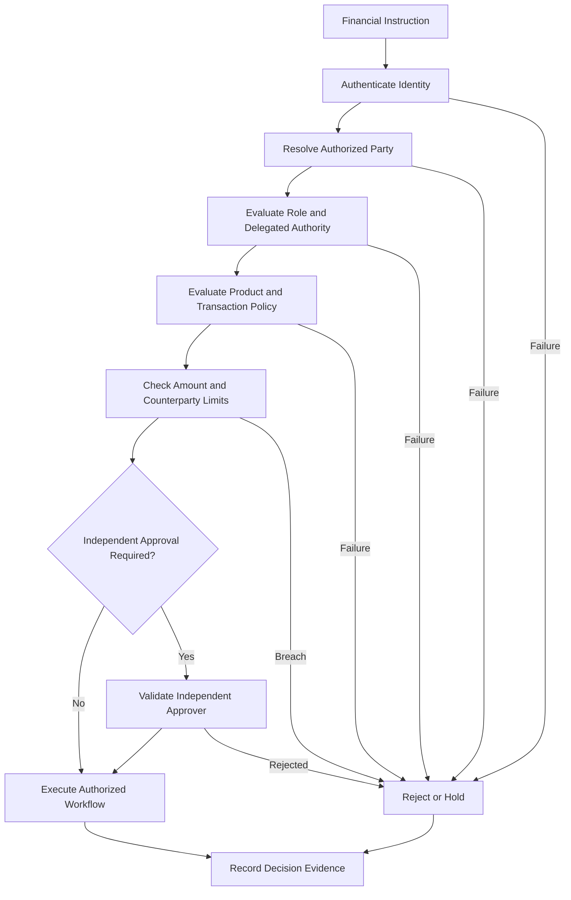

## 13.2 Approval matrix

| Operation | Initiator | Control | Final authority |
|---|---|---|---|
| Customer eligibility | Onboarding / RM | Compliance checks | Authorized onboarding function |
| Deposit creation | Customer / Maker | Product and funding validation | Approved policy or Checker |
| Material issuance | Issuance service | Independent verification | Authorized issuance approver |
| Routine transfer | Authorized holder | Transfer policy | Approved transaction policy |
| High-value transfer | Authorized initiator | Independent approval | Delegated approver |
| Wholesale placement | Treasury Dealer | Counterparty and limit checks | Treasury Manager |
| Product change | Product Manager | Testing and governance | Product governance authority |
| Restriction release | Compliance function | Evidence and scope review | Authorized compliance approver |
| Emergency pause | Designated incident authority | Scope and impact logging | Emergency governance process |
| Reconciliation adjustment | Finance / Operations | Independent review | Authorized finance approver |

Approvals should bind to the exact transaction details, including amount, currency, beneficiary, product version, and relevant transaction digest. Any material change invalidates the previous approval.

---

# 14. Deposit Issuance Workflow

## 14.1 Business sequence

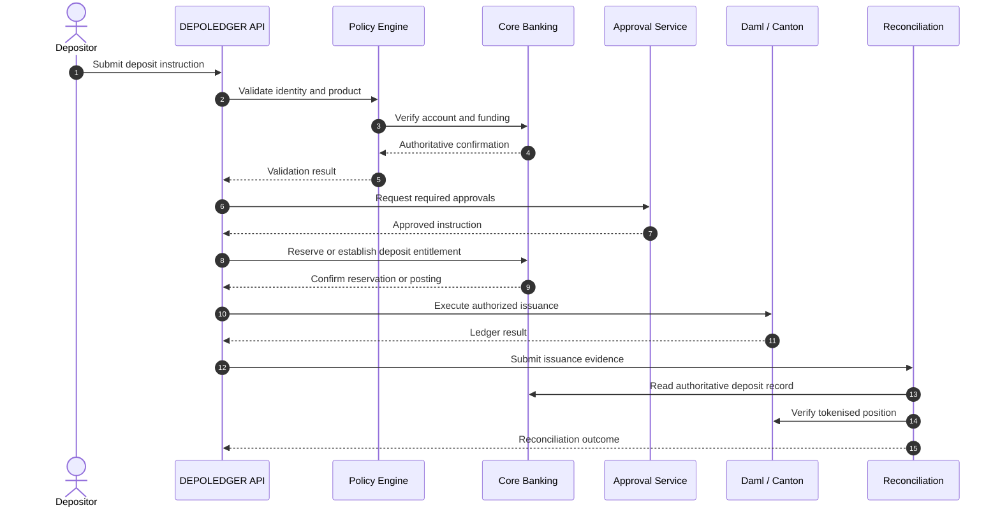

This sequence is logical. The exact ordering depends on the bank's authoritative posting model and the capabilities of the selected integration systems.

## 14.2 Preconditions

- The depositor and account are eligible.
- The product version is approved.
- The instruction is authorized.
- Required screening has passed or an approved decision permits processing.
- The amount and currency are valid.
- Funding or deposit entitlement has been confirmed.
- Required approvals are complete.
- Duplicate issuance is prevented.

## 14.3 Outcomes

| Outcome | Meaning |
|---|---|
| `PENDING_APPROVAL` | Required authorization is incomplete |
| `FUNDING_UNCONFIRMED` | Authoritative funding evidence is missing |
| `ISSUANCE_PENDING` | The issuance workflow is in progress |
| `ISSUANCE_FAILED` | Failure has been established |
| `RECONCILIATION_EXCEPTION` | Records do not yet agree |
| `ISSUED_AND_RECONCILED` | The defined issuance completion criteria are satisfied |

The system must not mark issuance as complete simply because a ledger submission was accepted.

---

# 15. Token Transfer Workflow

## 15.1 Transfer sequence

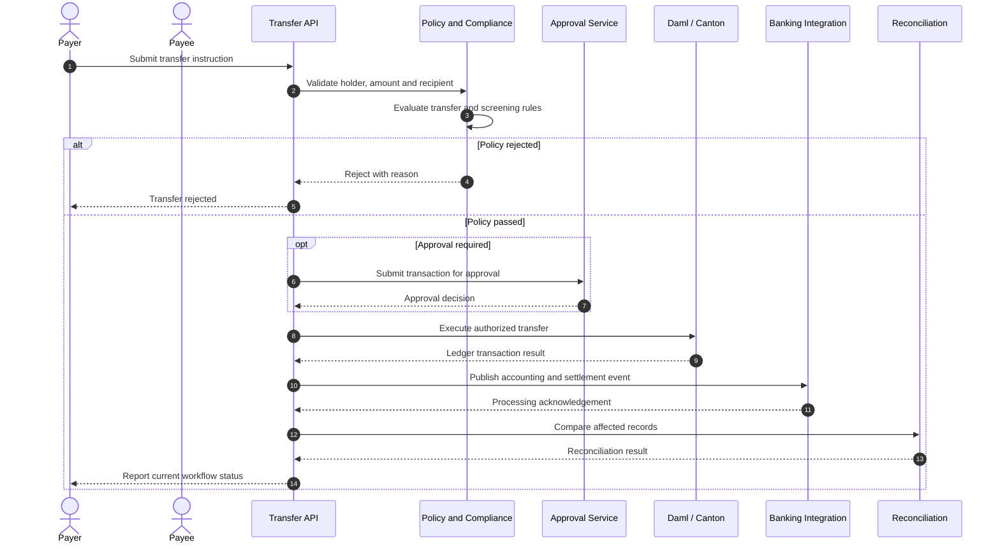

## 15.2 Transfer controls

- Validate the current holder and applicable authorization.
- Check the available amount and any holds.
- Enforce product-specific transferability.
- Validate recipient eligibility.
- Apply required compliance and fraud controls.
- Bind approvals to the exact transaction.
- Prevent replay and duplicate execution.
- Track ledger, banking, and reconciliation outcomes separately.

For interbank transfers, the workflow must distinguish ledger execution from payment settlement and applicable legal finality.

---

# 16. Redemption and Withdrawal Workflow

## 16.1 Redemption sequence

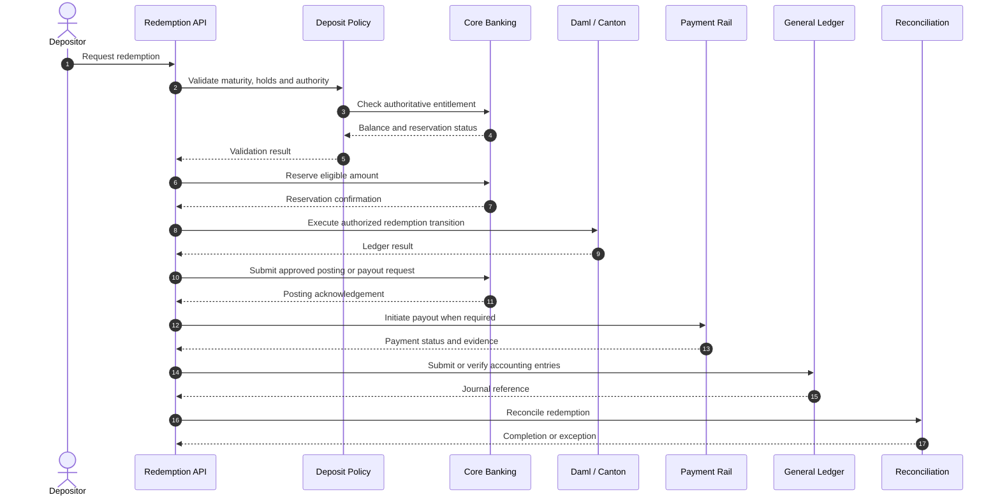

The actual sequence must be selected according to the bank's posting model, reservation capabilities, ledger design, and payout rules. The diagram does not establish atomicity between these systems.

## 16.2 Redemption controls

- Prevent simultaneous withdrawals from spending the same available amount.
- Reserve or lock the eligible amount when required.
- Use a unique redemption operation identifier.
- Handle uncertain payment outcomes without blindly retrying payouts.
- Retire or update the token representation according to the approved protocol.
- Preserve payment and accounting evidence.
- Route unresolved failures to a controlled recovery queue.

---

# 17. Time Deposits, Interest, and Maturity

## 17.1 Maturity workflow

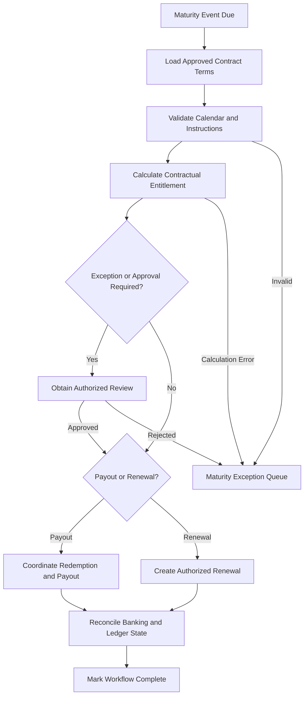

## 17.2 Required rules

- Store the contractual terms applicable at origination.
- Version calculation methodology and product rules.
- Define the day-count convention, rounding rules, calendar, and timezone.
- Prevent duplicate accrual postings and rollover instructions.
- Apply early redemption only where the contract permits it.
- Route disputed calculations and failed payouts to authorized reviewers.
- Reconcile the final contractual entitlement with the bank's records.

Interest and maturity calculations may be performed by a dedicated service. Daml contracts should enforce the appropriate approved inputs, authorization, and workflow constraints rather than assuming that every calculation belongs on-ledger.

---

# 18. Treasury and Interbank Funding

## 18.1 Funding workflow

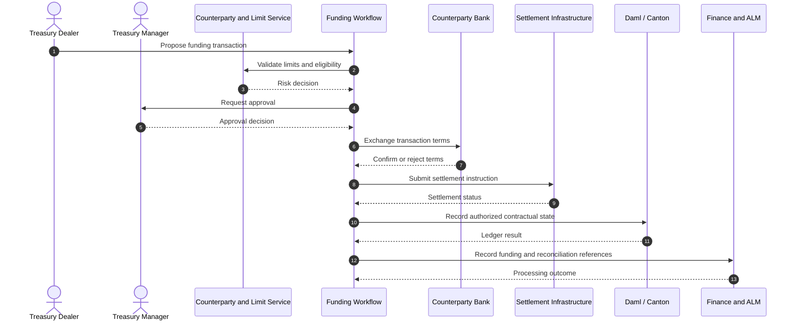

The position of ledger recording relative to external settlement must be explicitly chosen for the applicable product and legal model.

## 18.2 Controls

- Counterparty eligibility and exposure limits.
- Authorized dealer and manager mandates.
- Bilateral confirmation of material terms.
- Currency, tenor, rate, and maturity validation.
- Payment and settlement confirmation.
- Funding concentration and liquidity monitoring.
- Accounting reconciliation.
- Maturity and repayment monitoring.

---

# 19. Brokered, Structured, and Islamic Deposits

These product families should be added only after their contractual and regulatory requirements have been defined.

## 19.1 Brokered deposits

Required capabilities include:

- Broker authorization.
- Depositor identity and beneficial ownership checks.
- Deposit provenance and intermediary references.
- Contract-specific transfer and servicing permissions.
- Broker reporting and fee reconciliation where applicable.

The broker must not automatically be treated as the beneficial owner.

## 19.2 Structured deposits

Required capabilities include:

- Approved product documentation.
- Versioned payoff formulas.
- Authorized observation sources.
- Deterministic calculation logic.
- Independent model validation.
- Dispute handling and calculation evidence.
- Maturity and redemption coordination.

## 19.3 Islamic deposit arrangements

Potential structures include Mudarabah, Wakalah, and applicable Commodity Murabaha arrangements, subject to the bank's legal and Sharia review.

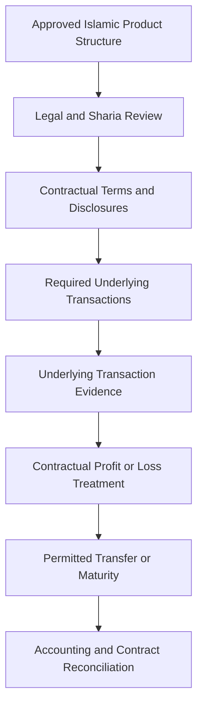

The platform must not assume that every Islamic deposit has the same economic or legal characteristics as a conventional interest-bearing deposit.

---

# 20. Workflow Orchestration and State Machines

DEPOLEDGER must represent workflow progress explicitly. A successful HTTP response or accepted ledger command is not sufficient evidence that a financial operation is complete.

## 20.1 Universal transaction lifecycle

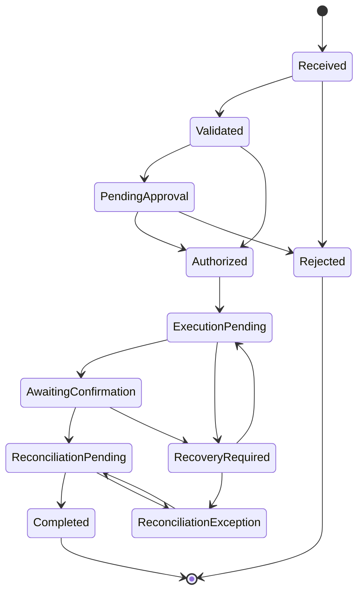

The actual state machine must be specialized for each financial operation. Not every workflow requires an external payment or the same approval sequence.

## 20.2 Separate state dimensions

| State dimension | Examples |
|---|---|
| Deposit lifecycle | Pending, active, matured, closed |
| Token lifecycle | Not issued, active, frozen, redeemed |
| Transaction lifecycle | Received, validated, executing, completed, failed |
| Settlement lifecycle | Not required, pending, confirmed, failed, unknown |
| Reconciliation lifecycle | Unreconciled, matched, exception, resolved |
| Compliance lifecycle | Pending, cleared, review required, restricted |

An active deposit may have a pending transfer. A token may be frozen while the contractual deposit obligation remains outstanding. A ledger transaction may succeed while external settlement is unresolved.

These conditions must never be collapsed into a single status.

## 20.3 Failure recovery

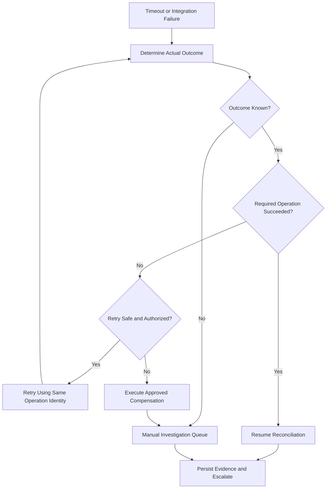

### Recovery requirements

- Stable operation identifiers.
- Durable orchestration state.
- Idempotent commands and deduplication.
- Explicit timeout and unknown-outcome states.
- Controlled retry and compensation policies.
- Independent reconciliation after recovery.
- Human review for ambiguous financial outcomes.
- Evidence preservation for every recovery action.

Compensation is not equivalent to erasing an executed financial event. Settled history must remain attributable and auditable.

---

# 21. Core Banking and Settlement Integration

## 21.1 Integration architecture

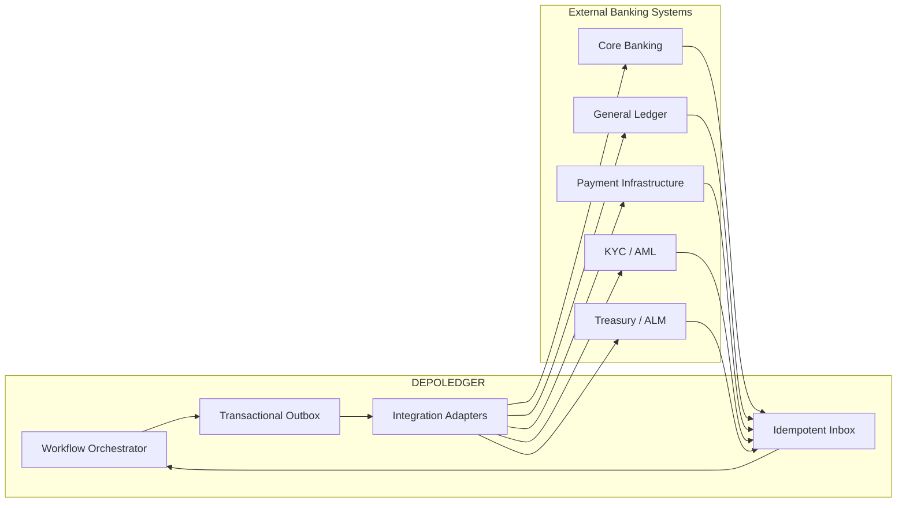

## 21.2 Integration rules

1. Define the authoritative source for each field and event.
2. Use versioned APIs and message schemas.
3. Assign stable correlation and idempotency identifiers.
4. Assume messages can be duplicated, delayed, or delivered out of order.
5. Use transactional outbox/inbox patterns where appropriate.
6. Verify external operation outcomes before retrying irreversible effects.
7. Separate ledger submission, core banking posting, and payment confirmation.
8. Reconcile continuously and perform independent end-of-day checks.
9. Apply least-privilege service credentials.
10. Preserve integration evidence for audit and incident investigation.

---

# 22. Accounting and Reconciliation

DEPOLEDGER reconciles three distinct financial records:

1. The bank's authoritative deposit records.
2. The Daml/Canton representation and transaction history.
3. The general ledger and relevant settlement or suspense accounts.

## 22.1 Reconciliation architecture

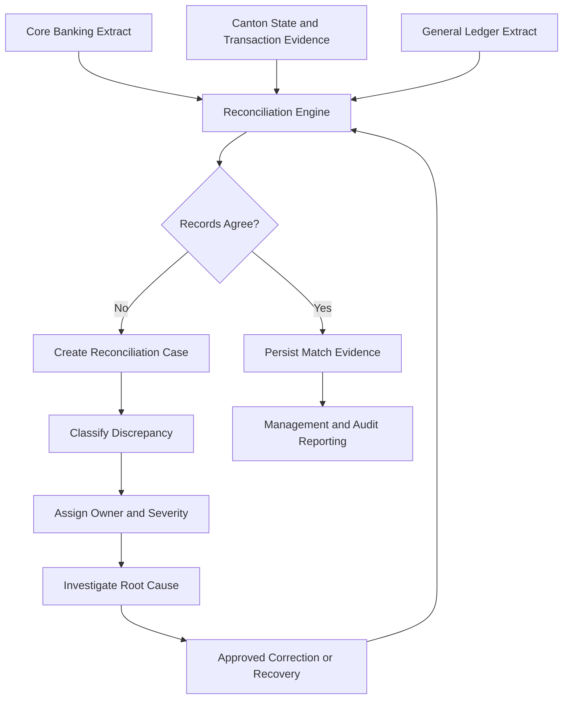

## 22.2 Exception categories

- Token representation without an authorized deposit entitlement.
- Missing or stale token representation.
- Mismatched token and deposit balances.
- Duplicate or incomplete accounting entries.
- Missing or contradictory settlement evidence.
- Duplicate interest, maturity, or redemption processing.
- Unauthorized operations involving restricted accounts.
- Inconsistent external status or delayed integration messages.

Each exception must have:

- A unique case identifier.
- Severity and creation timestamp.
- An accountable owner.
- Evidence and related operation identifiers.
- A remediation deadline.
- An escalation policy.
- An approved resolution record.

Corrections must not rely on silent database edits or unrestricted balance rewrites.

---

# 23. Security Architecture

## 23.1 Security control layers

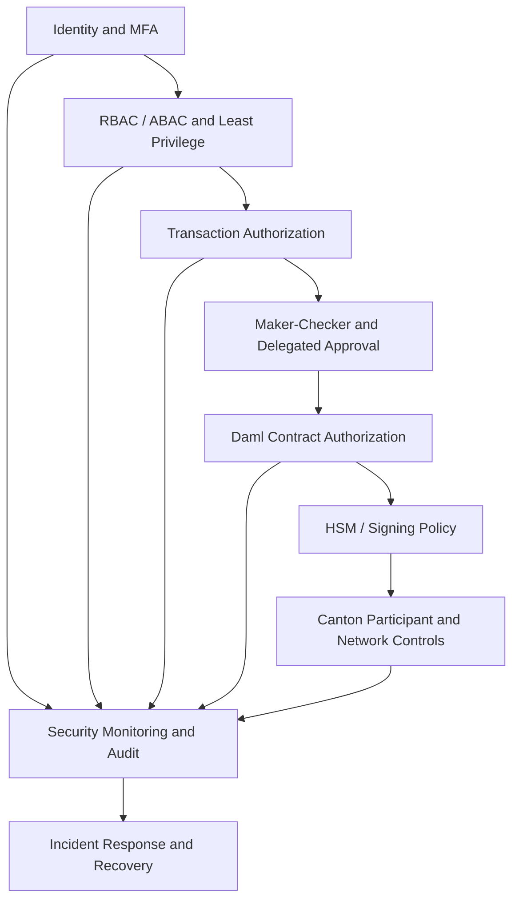

## 23.2 Threat model

| Threat | Required controls |
|---|---|
| Unauthorized issuance | Approved workflow, authority checks, authoritative deposit evidence |
| Double redemption | Reservations, idempotency, concurrency controls, reconciliation |
| Compromised signing key | HSM controls, restricted signing, rotation, emergency containment |
| Insider manipulation | Separation of duties, privileged access monitoring, independent review |
| Fraudulent recipient | Eligibility checks, transaction monitoring, recipient controls |
| Replay attacks | Stable operation IDs, nonces where appropriate, durable deduplication |
| Core banking outage | Durable workflow state, recovery queue, controlled reconciliation |
| Malicious product configuration | Versioning, approval, testing, controlled activation |
| Privacy leakage | Data minimization, authorized visibility, encryption, access reviews |
| Integration compromise | Mutual authentication, least privilege, message validation |
| Conflicting settlement status | Authoritative status mapping and exception handling |

Security assurance must include code review, static and dynamic testing, threat modeling, authorization testing, privacy testing, and independent assessment. No architecture can guarantee the elimination of every vulnerability.

---

# 24. Privacy and Data Governance

Canton's privacy model and Daml contract visibility must be incorporated into the data architecture.

```mermaid
flowchart TB
    CustomerData["Customer Identity and KYC"]
    BankSystems["Bank-Controlled Systems"]
    References["Minimized Contract References"]
    Daml["Daml Contracts"]
    Canton["Canton Transaction Privacy"]
    Audit["Authorized Audit Evidence"]

    CustomerData --> BankSystems
    BankSystems --> References
    References --> Daml
    Daml --> Canton
    BankSystems --> Audit
    Canton --> Audit
```

### Requirements

- Avoid placing unnecessary personal information in contracts.
- Define signatories and observers according to legitimate business need.
- Validate which parties can see contract data and transaction details.
- Encrypt sensitive information in transit and at rest.
- Apply retention and deletion policies appropriate to legal obligations.
- Restrict cross-bank disclosure.
- Keep operational logs free of unnecessary customer secrets.
- Document audit and regulator access requirements.
- Evaluate whether off-ledger evidence references remain accessible for the required retention period.

A permissioned ledger is not automatically private merely because participation is restricted.

---

# 25. Deployment Architecture

A production deployment should separate development, testing, staging, and production environments.

```mermaid
flowchart TB
    subgraph Development["Development"]
        Dev["Developer Workstation"]
        Build["Build and Unit Tests"]
    end

    subgraph CI["CI Pipeline"]
        Quality["Static Analysis and Tests"]
        Package["Package and Artifact Verification"]
        Approval["Release Approval"]
    end

    subgraph Staging["Staging Environment"]
        StageAPI["Application Services"]
        StageLedger["Test Canton Network"]
        StageCBS["Banking Test Adapters"]
    end

    subgraph Production["Production Environment"]
        Gateway["API Gateway"]
        Services["DEPOLEDGER Services"]
        Workflow["Durable Workflow Service"]
        Canton["Production Canton Network"]
        CBS["Core Banking"]
        GL["General Ledger"]
        Payment["Payment Infrastructure"]
        HSM["HSM / Key Custody"]
        Monitoring["Monitoring and Audit"]
    end

    Dev --> Build
    Build --> Quality
    Quality --> Package
    Package --> Approval
    Approval --> StageAPI
    StageAPI --> StageLedger
    StageAPI --> StageCBS

    StageAPI -. "Approved release" .-> Gateway
    Gateway --> Services
    Services --> Workflow
    Workflow --> Canton
    Workflow --> CBS
    Workflow --> GL
    Workflow --> Payment
    Services --> HSM

    Services --> Monitoring
    Workflow --> Monitoring
    Canton --> Monitoring
```

The diagram is a logical deployment view. It does not prescribe a specific Canton topology or imply that the bank's infrastructure can be replaced with a generic container deployment.

### Deployment requirements

- Environment-specific configuration and credentials.
- Segregated access to production signing authority.
- Controlled release approvals.
- Verified package and dependency provenance.
- Network segmentation and least-privilege connectivity.
- Backup and recovery procedures for applicable off-ledger state.
- Documented Canton participant operations and recovery procedures.
- Tested operational continuity and disaster recovery.
- No production secrets committed to source control.

---

# 26. Observability and Operational Resilience

## 26.1 Operational monitoring

```mermaid
flowchart LR
    APIs["API and Application Logs"]
    Workflows["Workflow Events"]
    Ledger["Canton Events"]
    Banking["Banking Integration Events"]
    Payments["Settlement Events"]

    Collect["Observability Pipeline"]
    Correlate["Correlation and Metrics"]
    Alert["Alerting and Incident Management"]
    Dashboard["Operations Dashboard"]
    Audit["Audit Evidence Store"]

    APIs --> Collect
    Workflows --> Collect
    Ledger --> Collect
    Banking --> Collect
    Payments --> Collect

    Collect --> Correlate
    Correlate --> Alert
    Correlate --> Dashboard
    Collect --> Audit
```

## 26.2 Required operational metrics

- Issuance success and exception rates.
- Transfer and redemption latency.
- Approval queue age.
- Pending and unknown settlement outcomes.
- Reconciliation mismatch count and age.
- Duplicate instruction detection.
- Failed external posting count.
- Interest and maturity processing exceptions.
- Workflow recovery attempts.
- Unauthorized operation attempts.
- Participant and integration availability.

Every financial operation should carry correlation identifiers across the API, workflow, ledger, core banking, payment, and accounting boundaries.

Logs and metrics must not expose unnecessary customer information or secrets.

---

# 27. Testing Strategy

## 27.1 Testing layers

```mermaid
flowchart TB
    Unit["Daml Unit and Contract Tests"]
    Authorization["Authorization and Privacy Tests"]
    Domain["Domain Invariant Tests"]
    Workflow["Workflow Scenario Tests"]
    Integration["Integration Tests"]
    Failure["Failure and Recovery Tests"]
    Security["Security Assessment"]
    UAT["Business Acceptance Testing"]
    Production["Production Readiness Approval"]

    Unit --> Domain
    Authorization --> Domain
    Domain --> Workflow
    Workflow --> Integration
    Integration --> Failure
    Failure --> Security
    Security --> UAT
    UAT --> Production
```

## 27.2 Daml contract tests

Test:

- Valid contract creation.
- Missing or invalid preconditions.
- Unauthorized choice execution.
- Invalid amounts and currencies.
- Product-specific lifecycle rules.
- Approval requirements.
- Transfer restrictions.
- Redemption and maturity conditions.
- Stakeholder visibility.
- Contract archival and replacement behavior.

## 27.3 Integration and resilience tests

Test:

- Core banking timeouts.
- Duplicate event delivery.
- Unknown payment outcomes.
- Failed ledger submissions.
- Participant unavailability.
- Duplicate payout prevention.
- Restart during workflow execution.
- Conflicting external statuses.
- Recovery after partial execution.
- End-of-day reconciliation.
- Disaster recovery.

## 27.4 Example acceptance scenarios

| Scenario | Expected result |
|---|---|
| Valid issuance | Authorized position created and reconciled |
| Duplicate issuance request | No second representation created |
| Unauthorized transfer | Ledger operation rejected |
| Ineligible recipient | Transfer rejected or held |
| Redemption timeout | Outcome investigated before retry |
| Duplicate maturity event | No duplicate entitlement or payout |
| Missing settlement confirmation | Workflow remains unresolved |
| Reconciliation mismatch | Exception recorded and assigned |
| Unauthorized restriction release | Operation rejected |
| Product terms changed after issuance | Existing contractual terms remain governed by the original version |

---

# 28. Development Environment

## 28.1 Prerequisites

Install and verify:

- The Daml SDK or supported DPM toolchain configured for the repository.
- A compatible Canton runtime for the target environment.
- Git.
- A Daml-compatible editor configuration.
- Backend and integration dependencies as they are introduced.

## 28.2 Clone and inspect

```bash
git clone <repository-url>
cd depoledger
git status
```

Replace `<repository-url>` with the actual repository address.

Confirm that `daml.yaml` exists and that the project points to the intended Daml source directories.

## 28.3 Build and test

Common Daml project commands include:

```bash
daml build
daml test
```

Use the commands supported by the installed SDK or DPM version. Consult the repository's package scripts and toolchain configuration where applicable.

## 28.4 Development workflow

1. Implement one small domain module.
2. Build the package.
3. Add contract and authorization tests.
4. Validate privacy and party visibility.
5. Add workflow orchestration only after ledger-side rules are clear.
6. Introduce one external integration at a time.
7. Add failure and recovery tests.
8. Update the documentation and architecture decisions.
9. Review security and operational implications before expanding scope.

Do not connect production keys or live payment infrastructure to an unvalidated development environment.

---

# 29. Regulatory and Legal Considerations

DEPOLEDGER is a technical architecture, not a regulatory approval or legal classification.

Before deployment, the bank must establish:

- Whether the proposed token represents a deposit claim under applicable law.
- The issuing bank's contractual obligations.
- The holder's rights to transfer, redeem, withdraw, and receive interest or profit.
- The applicability of deposit-protection arrangements.
- The treatment of insolvency, disputes, holds, and enforcement.
- The applicable KYC, AML, sanctions, privacy, and record-retention requirements.
- The legal and operational treatment of interbank transfers.
- The relevant accounting and regulatory reporting requirements.
- The contractual and governance requirements for structured and Islamic deposit arrangements.
- The approvals required for the selected network and operating model.

For an Indian bank, the legal design must be reviewed against applicable Reserve Bank of India requirements, payment-system rules, data-protection requirements, and the bank's contractual and supervisory obligations.

A tokenised deposit must not automatically be treated as equivalent to a stablecoin, a public-chain cryptoasset, or a central bank digital currency.

---

# 30. Implementation Roadmap

```mermaid
flowchart LR
    P0["P0 Foundation"]
    P1["P1 Deposit Core"]
    P2["P2 Transfers and Redemption"]
    P3["P3 Banking Integration"]
    P4["P4 Deposit Servicing"]
    P5["P5 Treasury and Interbank"]
    P6["P6 Independent Assurance"]

    P0 --> P1
    P1 --> P2
    P2 --> P3
    P3 --> P4
    P4 --> P5
    P5 --> P6
```

| Phase | Scope | Exit criteria |
|---|---|---|
| P0 — Foundation | Domain model, parties, product definitions, authorization | Buildable package and reviewed invariants |
| P1 — Deposit core | Deposit agreement, issuance requests, approvals | Contract and authorization tests pass |
| P2 — Transfers and redemption | Controlled position changes and withdrawal workflows | Duplicate and unauthorized operations are rejected |
| P3 — Banking integration | Core banking, GL, compliance, payment adapters | Integration recovery and reconciliation tests pass |
| P4 — Deposit servicing | Interest, maturity, notice, renewal | Product-specific lifecycle tests pass |
| P5 — Institutional funding | Treasury placements and interbank workflows | Counterparty and settlement controls pass |
| P6 — Independent assurance | Security, resilience, legal and operational review | Formal production approval |

The phases may overlap after the foundational architecture and control decisions have been approved.

---

# 31. Production Readiness

## 31.1 Financial integrity

- [ ] Every issued representation maps to an authorized deposit entitlement.
- [ ] Duplicate issuance and redemption are prevented.
- [ ] Contract authorization and party visibility are tested.
- [ ] Available balances and holds are handled correctly.
- [ ] External payment status is independently confirmed.
- [ ] Core banking, ledger, and accounting differences are detected.
- [ ] Corrections are authorized and auditable.

## 31.2 Workflow correctness

- [ ] Maker-checker requirements are enforced.
- [ ] Approval decisions bind to exact transaction details.
- [ ] Retries are safe and idempotent.
- [ ] Unknown outcomes are handled explicitly.
- [ ] Recovery procedures have been tested.
- [ ] Maturity and interest calculations pass boundary tests.

## 31.3 Security and operations

- [ ] Privileged access and key custody are validated.
- [ ] Security and privacy testing is complete.
- [ ] Critical vulnerabilities are remediated.
- [ ] Observability and incident response are operational.
- [ ] Disaster recovery has been exercised.
- [ ] Audit evidence can reconstruct the complete workflow.

## 31.4 Legal and regulatory

- [ ] The deposit claim and customer rights have been reviewed.
- [ ] Applicable regulatory requirements have been assessed.
- [ ] Product disclosures and contractual terms are approved.
- [ ] Data governance and retention are defined.
- [ ] Required supervisory and institutional approvals are documented.

A checklist is a planning aid. Each criterion requires verifiable evidence, test results, and accountable sign-off.

---

# 32. Glossary

| Term | Meaning |
|---|---|
| Daml | A language for modeling agreements and authorized ledger operations |
| Canton | A privacy-oriented distributed ledger protocol and ecosystem |
| Contract | A ledger agreement governed by Daml template rules |
| Signatory | A party required to authorize contract creation |
| Controller | A party whose authority is required to exercise a choice |
| Observer | A party granted visibility under the contract's stakeholder configuration |
| Bounded context | A domain boundary with explicit business responsibility |
| Hexagonal architecture | An architecture separating domain logic from external adapters |
| Core banking | The bank's authoritative deposit and account servicing system, where designated |
| GL | General ledger |
| RTGS | Real-time gross settlement |
| Maker-checker | A control separating transaction initiation and independent approval |
| Idempotency | A property ensuring duplicate processing does not create duplicate effects |
| Reconciliation | Comparing authoritative records and resolving discrepancies |
| Finality | The point at which an operation is considered final under the relevant technical, contractual, and legal rules |
| ALM | Asset-liability management |
| HSM | Hardware security module |

---

# Final Architecture Principle

DEPOLEDGER aims to provide the controlled financial workflow layer between a bank's contractual deposit obligations and their permitted digital representation.

Daml provides the contract-oriented modeling foundation. Canton provides the permissioned ledger environment when selected. Banking adapters, durable workflow orchestration, settlement coordination, compliance integration, accounting controls, and reconciliation complete the operating model.

**Every tokenised deposit operation must be authorized, contractually valid, operationally recoverable, and reconcilable with the bank's authoritative financial records.**

Programmability is valuable only when it operates within those boundaries.
